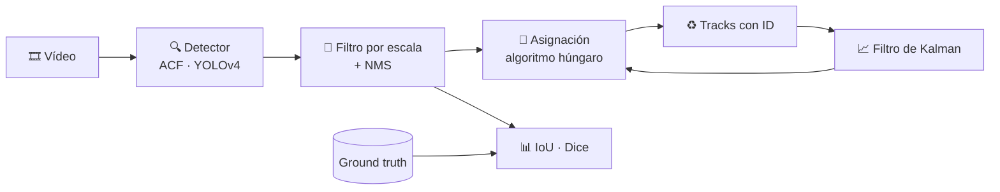

<div align="center">

# 👁️ Visión Artificial
### Prácticas y trabajo final en MATLAB


**Isaac Marval · Diego Peña**

</div>

---

## 🚶 Trabajo final: Pedestrian Tracking

> **¿Cómo cambia la calidad del seguimiento de peatones según el detector que usemos?**

Hemos construido en MATLAB un sistema completo de **detección + seguimiento de personas en vídeo** y lo hemos usado para comparar detectores clásicos (**ACF** entrenado en Caltech e INRIA) con una red profunda moderna (**YOLOv4**), manteniendo igual el resto del sistema.



| | |
|---|---|
| 🔍 **Detección** | `peopleDetectorACF` (Caltech e INRIA) y `yolov4ObjectDetector` (COCO, con GPU opcional). |
| 📈 **Seguimiento** | Un filtro de Kalman de velocidad constante por persona, asignación detección ↔ track con coste `1 − IoU` y gestión de altas y bajas de tracks. |
| 📏 **Evaluación** | **IoU** y **Dice** frente a un *ground truth* anotado, con sincronización vídeo ↔ anotaciones configurable. |
| 🎥 **Datos** | Vídeo de cámara fija **PETS09-S2L1** y ejemplo base de MathWorks (cámara en un coche). |

➡️ **[Ver la documentación completa del trabajo final](trabajo-final-pedestrian-tracking/README.md)**: pipeline paso a paso, detectores, métricas, parámetros, requisitos y cómo ejecutarlo.

---

## 🗂️ Prácticas

| Carpeta | Contenido |
|---|---|
| [`practica2`](practica2) | Operaciones básicas sobre imágenes y ruido |
| [`practica3`](practica3) | Práctica 3 |
| [`practica4`](practica4) | Características, transformada de Fourier, *local features*, FAST/LBP y texturas · `parte1`, `parte2` y `entrega` |
| [`practica5`](practica5) | Clasificación de dígitos (SVM + HOG) y *transfer learning* con GoogLeNet |
| [`practica6`](practica6) | Seguimiento con filtro de Kalman (*single* y *multi-track*) |
| [`trabajo-final-pedestrian-tracking`](trabajo-final-pedestrian-tracking) | **Trabajo final** |
| [`Imagenes`](Imagenes) | Imágenes compartidas por las prácticas |

## 🧰 Requisitos

- **MATLAB** con Computer Vision Toolbox, Image Processing Toolbox y Deep Learning Toolbox.
- Para YOLOv4: el paquete *Computer Vision Toolbox Model for YOLO v4 Object Detection*. GPU NVIDIA opcional.

## ▶️ Cómo empezar

```bash
git clone https://github.com/Marvali/Vision-Artificial-isaac-diego.git
```

Abre la carpeta de la práctica en MATLAB (como carpeta actual) y ejecuta el `.mlx` correspondiente.

## 📝 Notas

- Los autoguardados `.asv` de MATLAB están ignorados (`.gitignore`).
- Algunos scripts de la práctica 3 contienen rutas absolutas del equipo de sus autores; hay que ajustarlas para ejecutarlos en otro equipo.
- `Imagenes` conserva su nombre porque varios scripts hacen referencia a esa carpeta.
