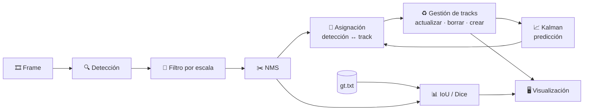

<div align="center">

# 🚶 Pedestrian Tracking
### Detección y seguimiento de peatones en vídeo: ACF (Caltech / INRIA) vs YOLOv4


**Trabajo final · Visión Artificial**
Isaac Marval · Diego Peña

[← Volver al README principal](../README.md)

</div>

---

## 📑 Índice

1. [¿De qué trata el proyecto?](#-de-qué-trata-el-proyecto)
2. [Qué hemos hecho nosotros](#-qué-hemos-hecho-nosotros)
3. [Cómo funciona: el pipeline paso a paso](#-cómo-funciona-el-pipeline-paso-a-paso)
4. [Los detectores comparados](#-los-detectores-comparados)
5. [Evaluación: IoU y Dice](#-evaluación-iou-y-dice)
6. [Datos](#-datos)
7. [Contenido de la carpeta](#-contenido-de-la-carpeta)
8. [Parámetros del tracker](#-parámetros-del-tracker)
9. [Requisitos y ejecución](#-requisitos-y-ejecución)
10. [Resultados](#-resultados)
11. [Limitaciones y trabajo futuro](#-limitaciones-y-trabajo-futuro)
12. [Créditos](#-créditos)

---

## 🎯 ¿De qué trata el proyecto?

**Seguir a una persona en un vídeo** parece fácil para un humano, pero para un ordenador es un problema con dos partes distintas:

- **Detectar**: en cada fotograma, ¿dónde hay peatones? El resultado son cajas (*bounding boxes*) sin identidad: el detector no sabe que la persona del frame 10 es la misma del frame 11.
- **Seguir (*tracking*)**: unir esas detecciones a lo largo del tiempo para que cada persona conserve **el mismo ID** durante todo el vídeo, aunque el detector falle en algún frame o dos personas se crucen.

Este trabajo construye un **sistema completo de detección + seguimiento en MATLAB** y lo usa como banco de pruebas para responder a una pregunta concreta:

> **¿Cómo cambia la calidad del seguimiento según el detector que le demos al mismo tracker?**

Para ello comparamos detectores clásicos (ACF, basados en características manuales) con una red profunda moderna (YOLOv4), manteniendo igual el resto del sistema, y medimos la calidad con un *ground truth* anotado a mano.

## 🛠️ Qué hemos hecho nosotros

Partimos del ejemplo oficial de MathWorks *Tracking Pedestrians from a Moving Car* (vídeo `vippedtracking.mp4`, cámara montada en un coche) y lo hemos ampliado:

| | Aportación |
|---|---|
| 🔁 | **Intercambio de detector**: el mismo tracker funciona con `peopleDetector`, ACF-Caltech, ACF-INRIA y YOLOv4. |
| 🎥 | **Nuevo escenario**: vídeo de cámara fija **PETS09-S2L1** (varias personas caminando, cruzándose y ocultándose). |
| 📏 | **Evaluación cuantitativa** frente a un *ground truth*: IoU y Dice por detección, con medias acumuladas en pantalla y resultado final por consola. |
| 🕒 | **Sincronización vídeo ↔ ground truth** configurable (`GT_RATIO`, `GT_OFFSET`), porque el vídeo y las anotaciones no tienen la misma tasa de frames. |
| ⚡ | **YOLOv4 con GPU** opcional: usa CUDA si está disponible y cae a CPU si no. |
| 🎛️ | **Ajuste de parámetros por detector** (umbrales de escala, *gating*, coste de no asignación, edad y visibilidad). |
| 🖼️ | **Visualización de diagnóstico**: GT en verde, detecciones crudas en rojo y tracks con ID y color propios. |

## 🧠 Cómo funciona: el pipeline paso a paso



### 1. Detección 🔍
El detector devuelve un conjunto de cajas por frame. Con los ACF se **reescala la imagen** (×1.5 en Caltech, ×2 en INRIA) para encontrar peatones pequeños; con YOLOv4 se aceptan solo las detecciones de la clase `person` con umbral de confianza 0.45.

### 2. Filtro por escala 📐
Un peatón lejano es pequeño y uno cercano es grande, y esa relación depende de la perspectiva de la cámara. `pedScaleTable.mat` (generada con `helperTableOfScales.m`) guarda la **altura esperada de una persona según la fila de la imagen en la que apoya los pies**. Si una caja mide mucho más o mucho menos que esa altura (tolerancia `scThresh`), se descarta como falso positivo.

### 3. Supresión de no máximos (NMS) ✂️
Los detectores suelen dar varias cajas casi idénticas para una misma persona. `selectStrongestBbox` se queda con una de cada grupo (solape máximo permitido: 0.6).

### 4. Predicción con filtro de Kalman 📈
Cada track tiene su propio **filtro de Kalman de velocidad constante** (`configureKalmanFilter('ConstantVelocity', …)`). Antes de mirar el frame nuevo, predice **dónde debería estar** cada persona según su movimiento anterior. Esto permite:
- asociar bien las detecciones aunque la persona se haya movido,
- **seguir "a ciegas"** unos frames cuando el detector falla o la persona queda tapada.

### 5. Asignación detección ↔ track 🔗
Se construye una matriz de costes donde `coste = 1 − IoU(caja predicha, caja detectada)`. Las asociaciones con muy poco solape se prohíben (*gating*, `gatingThresh`) y el resto se resuelve de forma óptima con el **algoritmo húngaro** (`assignDetectionsToTracks`), con un coste fijo `costOfNonAssignment` para decidir cuándo conviene no asignar.

### 6. Gestión del ciclo de vida de los tracks ♻️
- **Asignado** → se corrige el Kalman con la detección y se actualiza la caja.
- **Sin detección** → el track avanza con su predicción y envejece.
- **Perdido** → se elimina si ya tiene edad (`ageThresh`) y su **visibilidad** (frames con detección / edad) cae por debajo de `visThresh`.
- **Detección sin track** → nace un track nuevo con ID propio.

### 7. Visualización 🖥️
Cada track se dibuja con su ID y color. En los scripts de métricas se superponen además las cajas de ground truth (🟩 verde) y las detecciones crudas (🟥 rojo), junto con el IoU/Dice medio acumulado en pantalla.

## 🔬 Los detectores comparados

| Detector | Familia | Cómo "ve" a las personas | Ventajas | Inconvenientes |
|---|---|---|---|---|
| `peopleDetector('medium-network')` | Deep learning (MathWorks) | Red convolucional preentrenada | Equilibrada | Depende del paquete de modelos |
| `peopleDetectorACF('caltech-50x21')` | Clásico | *Aggregate Channel Features* + boosting, entrenado con Caltech (peatones vistos desde un coche, ventana 50×21) | Rápido, sin GPU | Pierde personas pequeñas u ocluidas |
| `peopleDetectorACF('inria-100x41')` | Clásico | Mismo método, entrenado con INRIA (peatones grandes y nítidos, ventana 100×41) | Cajas muy ajustadas en peatones grandes | Mal con peatones lejanos |
| `yolov4ObjectDetector('csp-darknet53-coco')` | Deep learning | Red *one-stage* de 80 clases (COCO); nos quedamos con `person` | Más robusto y preciso | Más pesado; la GPU ayuda mucho |

> Las ventanas 50×21 y 100×41 son las del modelo: el detector ACF busca personas con esa proporción y por eso la **escala de la imagen** influye tanto en sus resultados.

## 📊 Evaluación: IoU y Dice

Para cada caja detectada se busca la caja de ground truth con la que más se solapa y se calculan dos medidas entre 0 (nada en común) y 1 (coincidencia perfecta):

$$\text{IoU}=\frac{|A\cap B|}{|A\cup B|}\qquad\qquad \text{Dice}=\frac{2\,|A\cap B|}{|A|+|B|}$$

- **IoU (Jaccard)** → `bboxOverlapRatio(det, gt)`.
- **Dice** → `dice(maskDet, maskGT)`, comparando las máscaras rectangulares de ambas cajas (`rect2mask`).
- Una detección sin ningún GT cercano aporta **0** y penaliza la media: los falsos positivos bajan la nota.

Al terminar el vídeo se imprime `Mean IoU` y `Mean Dice`; durante la reproducción se muestran las medias acumuladas.

> ⚠️ **Sincronización:** el frame de GT usado en cada instante es `round(frame × GT_RATIO) + GT_OFFSET` (por defecto `2.0` y `0`). Si las cajas verdes van adelantadas o retrasadas respecto a las personas, hay que ajustar estos dos valores.

## 🗂️ Datos

| Archivo | Descripción |
|---|---|
| `PETS09-S2L1-raw.webm` | Vídeo **PETS09-S2L1**: cámara fija, varias personas caminando, cruzándose y ocultándose entre sí. |
| `vippedtracking.mp4` | Vídeo del ejemplo de MathWorks: cámara en un coche en movimiento. |
| `gt.txt` | *Ground truth* en formato MOT: `frame, id, x, y, w, h, …` |
| `detection.txt` | Detecciones de referencia en formato MOT. |
| `pedScaleTable.mat` | Altura esperada de un peatón por fila de la imagen. |

## 📁 Contenido de la carpeta

```
trabajo-final-pedestrian-tracking/
├── PedestrianTrackingFromMovingCameraExample.m          ← ejemplo base de MathWorks
├── PedestrianTrackingFromMovingCameraExample_CALTECH.mlx← ACF Caltech
├── PedestrianTracking_Caltech_Metrics.mlx               ← ACF Caltech + IoU/Dice
├── inra.mlx                                             ← ACF INRIA
├── inrametric.mlx                                       ← ACF INRIA + IoU/Dice
├── PedestrianTrackingFromMovingCameraYOLO4GPU.mlx       ← YOLOv4 (GPU/CPU)
├── PedestrianTrackingYOLOv4_GPU_DIAG.m                  ← YOLOv4 + IoU/Dice + sincronización con GT
├── helperTableOfScales.m                                ← genera pedScaleTable.mat
├── pedScaleTable.mat
├── gt.txt · detection.txt
├── PETS09-S2L1-raw.webm · vippedtracking.mp4
└── prueba.m                                             ← pruebas sueltas
```

## 🎛️ Parámetros del tracker

| Parámetro | Qué controla | Caltech | INRIA | YOLOv4 |
|---|---|:-:|:-:|:-:|
| `ROI` | Zona de la imagen donde se detecta `[x y w h]` | todo | todo | `[40 95 400 140]` |
| `scThresh` | Tolerancia en el filtro de escala | 0.4 | 0.3 | 0.3 |
| `gatingThresh` | Umbral para permitir una asignación | 0.7 | 0.7 | 0.9 |
| `costOfNonAssignment` | Coste de dejar un track o detección sin asignar | 20 | 20 | 10 |
| `ageThresh` | Edad mínima antes de poder borrar/mostrar un track | 4 | 4 | 3 |
| `visThresh` | Fracción mínima de frames con detección | 0.7 | 0.7 | 0.6 |

Filtro de Kalman en todos los casos: velocidad constante, ruido de movimiento `[2 1]`, ruido de medida `[5 5]`, incertidumbre inicial `100`.

## ▶️ Requisitos y ejecución

**Software**
- MATLAB con **Computer Vision Toolbox**, **Image Processing Toolbox** y **Deep Learning Toolbox**.
- Solo para YOLOv4: el paquete *Computer Vision Toolbox Model for YOLO v4 Object Detection* (Add-On Explorer).
- Opcional: **Parallel Computing Toolbox** y GPU NVIDIA con CUDA. Sin GPU funciona en CPU, más despacio.

**Pasos**

```bash
git clone https://github.com/Marvali/Vision-Artificial-isaac-diego.git
```

1. En MATLAB, poner como carpeta actual `trabajo-final-pedestrian-tracking` (los scripts leen vídeos, `gt.txt` y `pedScaleTable.mat` del directorio actual).
2. Abrir y ejecutar el script del detector que se quiera probar (tabla del apartado anterior).
3. Para cambiar de vídeo, editar `videoFile` y, si hace falta, `GT_RATIO` / `GT_OFFSET`.
4. Cerrar la ventana del reproductor para detener la ejecución; las métricas finales salen por consola.

## 📈 Resultados

Ventana de salida: 🟩 *ground truth* · 🟥 detecciones del detector · cajas de colores con ID = tracks.

> 📸 *Aquí conviene añadir capturas o un GIF del tracking en acción.* Guárdalos en una carpeta `docs/` y enlázalos, por ejemplo: ``.

| Detector | Mean IoU | Mean Dice | Observaciones |
|---|:-:|:-:|---|
| ACF Caltech | _por completar_ | _por completar_ | |
| ACF INRIA | _por completar_ | _por completar_ | |
| YOLOv4 | _por completar_ | _por completar_ | |

*Los valores salen por consola al finalizar cada script (`=== RESULTADOS FINALES ===`).*

## 🧩 Limitaciones y trabajo futuro

- **Métricas de detección, no de tracking completo**: IoU y Dice miden la calidad de las cajas, pero no cuántos cambios de identidad ocurren. Métricas MOT (MOTA, IDF1, ID switches) darían una visión más completa del seguimiento.
- **Oclusiones**: cuando dos personas se cruzan, el Kalman de velocidad constante puede intercambiar identidades. Se podría añadir un descriptor de apariencia (color/*re-identification*) a la asignación, como hacen DeepSORT o ByteTrack.
- **Sincronización manual** del GT con `GT_RATIO`/`GT_OFFSET`.
- **Un solo vídeo de evaluación**: sería interesante repetir en más secuencias y con otros detectores (YOLOv8+, Faster R-CNN).
- **Rendimiento**: medir fps de cada detector y estudiar el compromiso precisión/velocidad.

## 🙌 Créditos

- **Autores:** Isaac Marval y Diego Peña.
- **Ejemplo base:** *Tracking Pedestrians from a Moving Car*, © MathWorks.
- **Vídeo y anotaciones:** dataset **PETS 2009** (S2.L1).
- **Modelos:** Caltech y INRIA (ACF), YOLOv4 (COCO), distribuidos por MathWorks.
